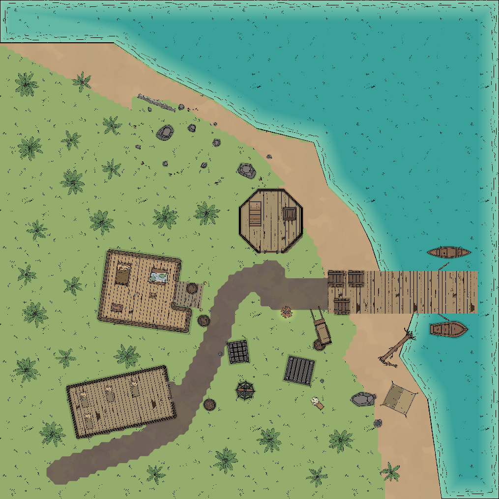

# Island visual revision — 0.7.1

2026-10-07. Protocol 23; 60 tools; Dungeondraft 1.2.0.1 / Godot 3.4.2.

The user rejected the first map's repetitive square cabins, walled prison pens
and detached rectangular rock terrace. Its technical checks passed, but that
did not establish visual acceptance. This revision replaces the example for
review; it does not claim the user has approved its appearance.

## Map changes

- Rotated 35 × 18 ft bunkhouse, irregular captain's cabin with wing/porch, and
  octagonal lookout. Furnishings and floor grain follow the building axes.
- Three exposed metal cages, no prison rooms or surrounding gate walls.
- Shoreline boulders and grass clusters replace the isolated gravel pad and
  cliff ring. Difficult sand and driftwood follow the coast.
- Separate native upper floor; editable prop/floor/deck layers; a separate
  roofed native snapshot leaves the combat interiors unobstructed.
- 5 ft tiles, 9 ft approach trail, 15 ft pier. Four ground routes and two upper
  routes pass for a 4 ft diameter agent; larger creatures still need review.

## Bridge corrections and evidence

Native `SetCustomColor` updates an existing shader, but `CreateObject` plus
`SetTexture` does not initialize that shader. Newly placed tinted beds/tent
showed the asset's raw red mask. The bridge now constructs props through public
[Objects.LoadObject](https://megasploot.github.io/DungeondraftModdingAPI/reference/Objects/),
using native serialized vectors and tint. This also registers native search/IDs.
Under sorting reindexes after moving the child; it does not register twice.
Duplicating uses `Prop.Save(true)` so tint, shadow, mirror and layer survive with
a distinct ID. Undo snapshots use the public color accessors.

`modify_object(color=...)` rejects an object without initialized tint before
editing anything. Create such objects with an explicit color. We did not mutate
the documented read-only Sprite or re-load an existing prop with a conflicting
node ID to initialize its shader.

Installed native IL confirms `PatternShapes.AddPolygon` converts the UI degree
value to radians before `PatternShape.SetOptions`. The bridge's extra SetOptions
call previously passed degrees directly and overwrote that correct value. It
now converts degrees, matching the advertised MCP interface.

Native roof previews exposed another documentation error: gable ends do not
extend a short ridge to cover the whole building. Full-length ridges with
width equal to half the short dimension, plus eaves, covered the buildings.
The tool description now distinguishes this from hip-roof end geometry.

## Verification

- Live tinted placement, under sorting, duplicate identity/tint/layer and
  create undo/redo passed; temporary test props were removed.
- Fresh native reload passed: Ground has 76 objects, 6 walls, 3 open doors,
  3 paths, 1 light, 5 pattern floors, no roofs. Objects use layers 0/20/200;
  floors use −100 and the pier uses 100.
- Upper has 4 props, 1 octagonal wall and 4 floor polygons around a real hatch.
- The saved-map runner verifies both floors, native layer persistence, three
  cage assets, six routes and the populated-open rejection; it leaves Ground
  selected. Both native PNGs were visually reviewed after the fresh launch.
- Final captured native stderr is empty. A prior fresh launch failed with
  native `GDMonoInternals !klass` before the bridge started; the next launch and
  final persistence check succeeded. This native startup issue is not claimed fixed.

Run the revised `scripts/verify_island_project.py` on the **revised** bundle,
not the rejected first version; see FULL_MAP_REVIEW.md for the command.
The committed core specification includes terrain, building outlines and palms.
Cages, furnishings, floorboards and the upper floor are additional native edits
retained in the saved project, not generated by the core example alone.

Ground Universal VTT/Foundry files remain single-level. Foundry runtime import
is unverified. Height, cover, locks and localized rough footing need explicit
DM rulings; structural connectivity is separate from artwork review.
